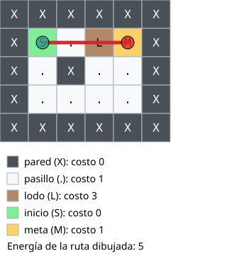
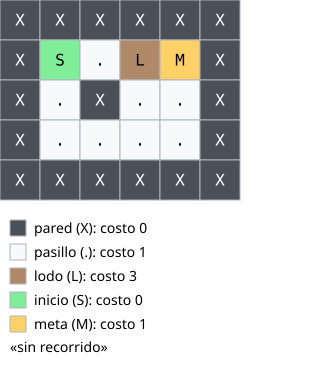
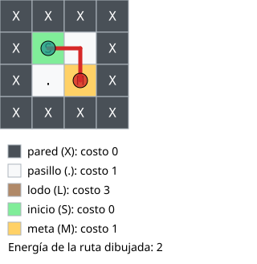
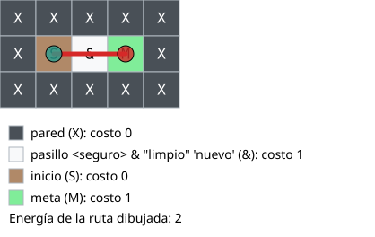

# Pruebas

Este documento es material para el informe PDF. Las entradas y salidas se copiaron de los archivos generados al ejecutar el programa. En los mensajes de pantalla, `<raíz>` reemplaza la ruta de la carpeta del proyecto.

## Verificación general

**Compilación con Elixir 1.20.3**

```text
(sin warnings ni errores)
```

**Comparación con los resultados de referencia**

| Comprobación | Resultado |
|---|---|
| Robot `valido`: CSV contra la referencia | Coincide |
| Robot `valido`: estado final de la relajación contra la referencia | Coincide |
| Robot `valido_comentarios`: todas las salidas contra `valido` | Coincide |
| ADN `valido`: CSV contra la referencia | Coincide |
| ADN `valido_comentarios`: CSV contra la referencia | Coincide |

## Problema 1: robot de rescate

### 1.1 Solución principal

#### `valido`: Caso válido, ejemplo del enunciado con B = 10

**Entrada `edificio.txt`**

```text
X X X X X X
X S . L M X
X . X . . X
X . . . . X
X X X X X X
```

**Entrada `terrenos.csv`**

```text
X,pared,no,0
.,pasillo,si,1
L,lodo,si,3
S,inicio,si,0
M,meta,si,1
```

**Entrada `bateria.txt`**

```text
10
```

**Pantalla**

```text
Total de recorridos: 6
Menor número de movimientos: 3
  Recorrido 1
    Coordenadas: (1,1)->(1,2)->(1,3)->(1,4)
    Movimientos: 3
    Direcciones: derecha, derecha, derecha
    Energía: 5
Menor energía: 5
  Recorrido 1
    Coordenadas: (1,1)->(1,2)->(1,3)->(1,4)
    Movimientos: 3
    Direcciones: derecha, derecha, derecha
    Energía: 5
Archivos generados en <raíz>/problema1_robot/salidas/valido

```

**Salida `recorridos_rescate.csv`**

```text
id;movimientos;energia;posiciones
1;3;5;(1,1)->(1,2)->(1,3)->(1,4)
2;5;7;(1,1)->(1,2)->(1,3)->(2,3)->(2,4)->(1,4)
3;7;9;(1,1)->(1,2)->(1,3)->(2,3)->(3,3)->(3,4)->(2,4)->(1,4)
4;7;9;(1,1)->(2,1)->(3,1)->(3,2)->(3,3)->(2,3)->(1,3)->(1,4)
5;7;7;(1,1)->(2,1)->(3,1)->(3,2)->(3,3)->(2,3)->(2,4)->(1,4)
6;7;7;(1,1)->(2,1)->(3,1)->(3,2)->(3,3)->(3,4)->(2,4)->(1,4)
```

**Salida `resumen_rescate.txt`**

```text
Total de recorridos: 6
Menor número de movimientos: 3
  Recorrido 1
    Coordenadas: (1,1)->(1,2)->(1,3)->(1,4)
    Movimientos: 3
    Direcciones: derecha, derecha, derecha
    Energía: 5
Menor energía: 5
  Recorrido 1
    Coordenadas: (1,1)->(1,2)->(1,3)->(1,4)
    Movimientos: 3
    Direcciones: derecha, derecha, derecha
    Energía: 5
```

#### `valido_comentarios`: Caso válido con comentarios y líneas vacías; sus salidas son iguales a las de valido

**Entrada `edificio.txt`**

```text
# Edificio del enunciado con comentarios

X X X X X X
X S . L M X
   # comentario con espacios antes
X . X . . X

X . . . . X
X X X X X X

```

**Entrada `terrenos.csv`**

```text
# simbolo,nombre,transitable,costo
X,pared,no,0

.,pasillo,si,1
L,lodo,si,3
# los dos extremos
S,inicio,si,0
M,meta,si,1
```

**Entrada `bateria.txt`**

```text
# presupuesto de energia

10
```

**Pantalla**

```text
Total de recorridos: 6
Menor número de movimientos: 3
  Recorrido 1
    Coordenadas: (1,1)->(1,2)->(1,3)->(1,4)
    Movimientos: 3
    Direcciones: derecha, derecha, derecha
    Energía: 5
Menor energía: 5
  Recorrido 1
    Coordenadas: (1,1)->(1,2)->(1,3)->(1,4)
    Movimientos: 3
    Direcciones: derecha, derecha, derecha
    Energía: 5
Archivos generados en <raíz>/problema1_robot/salidas/valido_comentarios

```

**Salida `recorridos_rescate.csv`**

```text
id;movimientos;energia;posiciones
1;3;5;(1,1)->(1,2)->(1,3)->(1,4)
2;5;7;(1,1)->(1,2)->(1,3)->(2,3)->(2,4)->(1,4)
3;7;9;(1,1)->(1,2)->(1,3)->(2,3)->(3,3)->(3,4)->(2,4)->(1,4)
4;7;9;(1,1)->(2,1)->(3,1)->(3,2)->(3,3)->(2,3)->(1,3)->(1,4)
5;7;7;(1,1)->(2,1)->(3,1)->(3,2)->(3,3)->(2,3)->(2,4)->(1,4)
6;7;7;(1,1)->(2,1)->(3,1)->(3,2)->(3,3)->(3,4)->(2,4)->(1,4)
```

**Salida `resumen_rescate.txt`**

```text
Total de recorridos: 6
Menor número de movimientos: 3
  Recorrido 1
    Coordenadas: (1,1)->(1,2)->(1,3)->(1,4)
    Movimientos: 3
    Direcciones: derecha, derecha, derecha
    Energía: 5
Menor energía: 5
  Recorrido 1
    Coordenadas: (1,1)->(1,2)->(1,3)->(1,4)
    Movimientos: 3
    Direcciones: derecha, derecha, derecha
    Energía: 5
```

#### `limite_b5`: Caso límite, B = 5, exactamente 1 recorrido

**Entrada `edificio.txt`**

```text
X X X X X X
X S . L M X
X . X . . X
X . . . . X
X X X X X X
```

**Entrada `terrenos.csv`**

```text
X,pared,no,0
.,pasillo,si,1
L,lodo,si,3
S,inicio,si,0
M,meta,si,1
```

**Entrada `bateria.txt`**

```text
5
```

**Pantalla**

```text
Total de recorridos: 1
Menor número de movimientos: 3
  Recorrido 1
    Coordenadas: (1,1)->(1,2)->(1,3)->(1,4)
    Movimientos: 3
    Direcciones: derecha, derecha, derecha
    Energía: 5
Menor energía: 5
  Recorrido 1
    Coordenadas: (1,1)->(1,2)->(1,3)->(1,4)
    Movimientos: 3
    Direcciones: derecha, derecha, derecha
    Energía: 5
Archivos generados en <raíz>/problema1_robot/salidas/limite_b5

```

**Salida `recorridos_rescate.csv`**

```text
id;movimientos;energia;posiciones
1;3;5;(1,1)->(1,2)->(1,3)->(1,4)
```

**Salida `resumen_rescate.txt`**

```text
Total de recorridos: 1
Menor número de movimientos: 3
  Recorrido 1
    Coordenadas: (1,1)->(1,2)->(1,3)->(1,4)
    Movimientos: 3
    Direcciones: derecha, derecha, derecha
    Energía: 5
Menor energía: 5
  Recorrido 1
    Coordenadas: (1,1)->(1,2)->(1,3)->(1,4)
    Movimientos: 3
    Direcciones: derecha, derecha, derecha
    Energía: 5
```

#### `limite_sin_ruta`: Caso límite, B = 4, la meta no es alcanzable

**Entrada `edificio.txt`**

```text
X X X X X X
X S . L M X
X . X . . X
X . . . . X
X X X X X X
```

**Entrada `terrenos.csv`**

```text
X,pared,no,0
.,pasillo,si,1
L,lodo,si,3
S,inicio,si,0
M,meta,si,1
```

**Entrada `bateria.txt`**

```text
4
```

**Pantalla**

```text
Total de recorridos: 0
No existe recorrido válido con B = 4
Archivos generados en <raíz>/problema1_robot/salidas/limite_sin_ruta

```

**Salida `recorridos_rescate.csv`**

```text
id;movimientos;energia;posiciones
```

**Salida `resumen_rescate.txt`**

```text
Total de recorridos: 0
No existe recorrido válido con B = 4
```

#### `limite_empates`: Caso límite, empate en ambos criterios

**Entrada `edificio.txt`**

```text
X X X X
X S . X
X . M X
X X X X
```

**Entrada `terrenos.csv`**

```text
X,pared,no,0
.,pasillo,si,1
L,lodo,si,3
S,inicio,si,0
M,meta,si,1
```

**Entrada `bateria.txt`**

```text
10
```

**Pantalla**

```text
Total de recorridos: 2
Menor número de movimientos: 2
  Recorrido 1
    Coordenadas: (1,1)->(1,2)->(2,2)
    Movimientos: 2
    Direcciones: derecha, abajo
    Energía: 2
  Recorrido 2
    Coordenadas: (1,1)->(2,1)->(2,2)
    Movimientos: 2
    Direcciones: abajo, derecha
    Energía: 2
Menor energía: 2
  Recorrido 1
    Coordenadas: (1,1)->(1,2)->(2,2)
    Movimientos: 2
    Direcciones: derecha, abajo
    Energía: 2
  Recorrido 2
    Coordenadas: (1,1)->(2,1)->(2,2)
    Movimientos: 2
    Direcciones: abajo, derecha
    Energía: 2
Archivos generados en <raíz>/problema1_robot/salidas/limite_empates

```

**Salida `recorridos_rescate.csv`**

```text
id;movimientos;energia;posiciones
1;2;2;(1,1)->(1,2)->(2,2)
2;2;2;(1,1)->(2,1)->(2,2)
```

**Salida `resumen_rescate.txt`**

```text
Total de recorridos: 2
Menor número de movimientos: 2
  Recorrido 1
    Coordenadas: (1,1)->(1,2)->(2,2)
    Movimientos: 2
    Direcciones: derecha, abajo
    Energía: 2
  Recorrido 2
    Coordenadas: (1,1)->(2,1)->(2,2)
    Movimientos: 2
    Direcciones: abajo, derecha
    Energía: 2
Menor energía: 2
  Recorrido 1
    Coordenadas: (1,1)->(1,2)->(2,2)
    Movimientos: 2
    Direcciones: derecha, abajo
    Energía: 2
  Recorrido 2
    Coordenadas: (1,1)->(2,1)->(2,2)
    Movimientos: 2
    Direcciones: abajo, derecha
    Energía: 2
```

#### `limite_criterios`: Caso límite, el de menos movimientos no es el de menor energía

**Entrada `edificio.txt`**

```text
X X X X X
X S L M X
X . . . X
X X X X X
```

**Entrada `terrenos.csv`**

```text
X,pared,no,0
.,pasillo,si,1
L,lodo,si,5
S,inicio,si,0
M,meta,si,1
```

**Entrada `bateria.txt`**

```text
10
```

**Pantalla**

```text
Total de recorridos: 4
Menor número de movimientos: 2
  Recorrido 1
    Coordenadas: (1,1)->(1,2)->(1,3)
    Movimientos: 2
    Direcciones: derecha, derecha
    Energía: 6
Menor energía: 4
  Recorrido 4
    Coordenadas: (1,1)->(2,1)->(2,2)->(2,3)->(1,3)
    Movimientos: 4
    Direcciones: abajo, derecha, derecha, arriba
    Energía: 4
Archivos generados en <raíz>/problema1_robot/salidas/limite_criterios

```

**Salida `recorridos_rescate.csv`**

```text
id;movimientos;energia;posiciones
1;2;6;(1,1)->(1,2)->(1,3)
2;4;8;(1,1)->(1,2)->(2,2)->(2,3)->(1,3)
3;4;8;(1,1)->(2,1)->(2,2)->(1,2)->(1,3)
4;4;4;(1,1)->(2,1)->(2,2)->(2,3)->(1,3)
```

**Salida `resumen_rescate.txt`**

```text
Total de recorridos: 4
Menor número de movimientos: 2
  Recorrido 1
    Coordenadas: (1,1)->(1,2)->(1,3)
    Movimientos: 2
    Direcciones: derecha, derecha
    Energía: 6
Menor energía: 4
  Recorrido 4
    Coordenadas: (1,1)->(2,1)->(2,2)->(2,3)->(1,3)
    Movimientos: 4
    Direcciones: abajo, derecha, derecha, arriba
    Energía: 4
```

### 1.2 Validación recursiva

#### `valido`: caso válido

**Salida `validacion_edificio.txt`**

```text
Sin errores de validación
```

#### `invalido`: Caso inválido, varios errores a la vez

**Entrada `edificio.txt`**

```text
X X X X X X
X S . L M X
# la siguiente fila es mas corta
X . X .
X S Z . . .
X X . X X X
```

**Entrada `terrenos.csv`**

```text
X,pared,no,0
.,pasillo,si,1
L,lodo,si,3
L,lodo_otra_vez,si,2
S,inicio,si,0
M,meta,si,1
R,rampa,si,0
Q,raro,quizas,1
W,agua,si,-2
faltan,campos
```

**Entrada `bateria.txt`**

```text
abc
7
```

**Pantalla**

```text
Se encontraron 13 errores de validación. Detalles en <raíz>/problema1_robot/salidas/invalido/validacion_edificio.txt
```

**Salida `validacion_edificio.txt`**

```text
Errores de validación encontrados: 13
terrenos.csv, línea 4: el símbolo L ya estaba definido en la línea 3
terrenos.csv, línea 7: el terreno transitable R debe tener costo positivo
terrenos.csv, línea 8: transitable debe ser si o no
terrenos.csv, línea 9: el costo no puede ser negativo
terrenos.csv, línea 10: se esperaban 4 campos y hay 2
edificio.txt, línea 4: la fila tiene 4 símbolos y se esperaban 6
edificio.txt, coordenada {3, 2}: el símbolo Z no está definido en terrenos.csv
edificio.txt: debe existir exactamente un S y hay 2 en {1, 1} {3, 1}
edificio.txt, coordenada {2, 3}: el borde debe ser X y hay .
edificio.txt, coordenada {3, 5}: el borde debe ser X y hay .
edificio.txt, coordenada {4, 2}: el borde debe ser X y hay .
bateria.txt: se esperaba una sola línea de datos y hay 2
bateria.txt, línea 1: B debe ser un entero y es abc
```

Archivos generados: validacion_edificio.txt . No se hizo relajación ni búsqueda.

#### `invalido_vacio`: Caso inválido, edificio sin filas

**Entrada `edificio.txt`**

```text
# este edificio no tiene filas

```

**Entrada `terrenos.csv`**

```text
X,pared,no,0
.,pasillo,si,1
L,lodo,si,3
S,inicio,si,0
M,meta,si,1
```

**Entrada `bateria.txt`**

```text
10
```

**Pantalla**

```text
Se encontraron 3 errores de validación. Detalles en <raíz>/problema1_robot/salidas/invalido_vacio/validacion_edificio.txt
```

**Salida `validacion_edificio.txt`**

```text
Errores de validación encontrados: 3
edificio.txt: el edificio está vacío
edificio.txt: debe existir exactamente un S y hay 0
edificio.txt: debe existir exactamente un M y hay 0
```

Archivos generados: validacion_edificio.txt . No se hizo relajación ni búsqueda.

#### `invalido_b_cero`: Caso inválido, B = 0 y meta no transitable

**Entrada `edificio.txt`**

```text
X X X X X X
X S . L M X
X . X . . X
X . . . . X
X X X X X X
```

**Entrada `terrenos.csv`**

```text
X,pared,no,0
.,pasillo,si,1
L,lodo,si,3
S,inicio,si,0
M,meta,no,1
```

**Entrada `bateria.txt`**

```text
0
```

**Pantalla**

```text
Se encontraron 2 errores de validación. Detalles en <raíz>/problema1_robot/salidas/invalido_b_cero/validacion_edificio.txt
```

**Salida `validacion_edificio.txt`**

```text
Errores de validación encontrados: 2
terrenos.csv, línea 5: el terreno M debe ser transitable
bateria.txt, línea 1: B debe ser positivo y es 0
```

Archivos generados: validacion_edificio.txt . No se hizo relajación ni búsqueda.

#### `faltante`: Caso límite, falta un archivo

**Entrada `edificio.txt`**

```text
X X X X X X
X S . L M X
X . X . . X
X . . . . X
X X X X X X
```

**Entrada `terrenos.csv`**

```text
X,pared,no,0
.,pasillo,si,1
L,lodo,si,3
S,inicio,si,0
M,meta,si,1
```

**Entrada `bateria.txt`:** no existe.

**Pantalla**

```text
Error: no existe el archivo <raíz>/problema1_robot/datos/faltante/bateria.txt
```

El programa termina sin excepción y no crea carpeta de salida.

### 1.3 SVG

#### `valido`: caso válido, ruta de menor energía remarcada



Conteo en el archivo: 30 casillas de 40 × 40, 3 segmentos `<line>`, 2 marcadores `<circle>`.

**Extracto**

```text
<svg xmlns="http://www.w3.org/2000/svg" width="320" height="368" viewBox="0 0 320 368">
<rect x="0" y="0" width="40" height="40" fill="#495057" stroke="#adb5bd"/>
<rect x="40" y="0" width="40" height="40" fill="#495057" stroke="#adb5bd"/>
<line x1="60" y1="60" x2="100" y2="60" stroke="#d62828" stroke-width="5" stroke-linecap="round"/>
<line x1="100" y1="60" x2="140" y2="60" stroke="#d62828" stroke-width="5" stroke-linecap="round"/>
<line x1="140" y1="60" x2="180" y2="60" stroke="#d62828" stroke-width="5" stroke-linecap="round"/>
<circle cx="60" cy="60" r="9" fill="#2a9d8f" fill-opacity="0.8" stroke="black"/>
<circle cx="180" cy="60" r="9" fill="#d62828" fill-opacity="0.8" stroke="black"/>
<text x="34" y="329" font-family="sans-serif" font-size="14" fill="black">meta (M): costo 1</text>
<text x="10" y="352" font-family="sans-serif" font-size="14" fill="black">Energía de la ruta dibujada: 5</text>
</svg>
```

#### `limite_sin_ruta`: caso límite, mapa sin ruta y leyenda «sin recorrido»



Conteo en el archivo: 30 casillas de 40 × 40, 0 segmentos `<line>`, 0 marcadores `<circle>`.

**Extracto**

```text
<svg xmlns="http://www.w3.org/2000/svg" width="320" height="368" viewBox="0 0 320 368">
<rect x="0" y="0" width="40" height="40" fill="#495057" stroke="#adb5bd"/>
<rect x="40" y="0" width="40" height="40" fill="#495057" stroke="#adb5bd"/>
<text x="34" y="329" font-family="sans-serif" font-size="14" fill="black">meta (M): costo 1</text>
<text x="10" y="352" font-family="sans-serif" font-size="14" fill="black">«sin recorrido»</text>
</svg>
```

#### `limite_empates`: caso límite, se dibuja el primero encontrado



Conteo en el archivo: 16 casillas de 40 × 40, 2 segmentos `<line>`, 2 marcadores `<circle>`.

**Extracto**

```text
<svg xmlns="http://www.w3.org/2000/svg" width="320" height="328" viewBox="0 0 320 328">
<rect x="0" y="0" width="40" height="40" fill="#495057" stroke="#adb5bd"/>
<rect x="40" y="0" width="40" height="40" fill="#495057" stroke="#adb5bd"/>
<line x1="60" y1="60" x2="100" y2="60" stroke="#d62828" stroke-width="5" stroke-linecap="round"/>
<line x1="100" y1="60" x2="100" y2="100" stroke="#d62828" stroke-width="5" stroke-linecap="round"/>
<circle cx="60" cy="60" r="9" fill="#2a9d8f" fill-opacity="0.8" stroke="black"/>
<circle cx="100" cy="100" r="9" fill="#d62828" fill-opacity="0.8" stroke="black"/>
<text x="34" y="289" font-family="sans-serif" font-size="14" fill="black">meta (M): costo 1</text>
<text x="10" y="312" font-family="sans-serif" font-size="14" fill="black">Energía de la ruta dibujada: 2</text>
</svg>
```

#### `limite_xml`: caso límite, texto XML escapado

**Entrada `edificio.txt`**

```text
X X X X X
X S & M X
X X X X X
```

**Entrada `terrenos.csv`**

```text
X,pared,no,0
&,pasillo <seguro> & "limpio" 'nuevo',si,1
S,inicio,si,0
M,meta,si,1
```

**Entrada `bateria.txt`**

```text
5
```



Conteo en el archivo: 15 casillas de 40 × 40, 2 segmentos `<line>`, 2 marcadores `<circle>`.

**Extracto**

```text
<svg xmlns="http://www.w3.org/2000/svg" width="418" height="264" viewBox="0 0 418 264">
<rect x="0" y="0" width="40" height="40" fill="#495057" stroke="#adb5bd"/>
<rect x="40" y="0" width="40" height="40" fill="#495057" stroke="#adb5bd"/>
<line x1="60" y1="60" x2="100" y2="60" stroke="#d62828" stroke-width="5" stroke-linecap="round"/>
<line x1="100" y1="60" x2="140" y2="60" stroke="#d62828" stroke-width="5" stroke-linecap="round"/>
<circle cx="60" cy="60" r="9" fill="#2a9d8f" fill-opacity="0.8" stroke="black"/>
<circle cx="140" cy="60" r="9" fill="#d62828" fill-opacity="0.8" stroke="black"/>
<text x="34" y="225" font-family="sans-serif" font-size="14" fill="black">meta (M): costo 1</text>
<text x="10" y="248" font-family="sans-serif" font-size="14" fill="black">Energía de la ruta dibujada: 2</text>
</svg>
```

Línea de la leyenda con el texto escapado:

```text
<text x="100" y="60" text-anchor="middle" dominant-baseline="central" font-family="monospace" font-size="16" fill="black">&amp;</text>
<text x="34" y="177" font-family="sans-serif" font-size="14" fill="black">pasillo &lt;seguro&gt; &amp; &quot;limpio&quot; &apos;nuevo&apos; (&amp;): costo 1</text>
```

#### `invalido`: caso inválido

No se genera SVG, porque la validación encontró errores.

Los 7 archivos SVG generados se cargaron como XML sin errores. Tres de ellos (`valido`, `limite_sin_ruta` y `limite_xml`) se abrieron además en Microsoft Edge y se revisaron a la vista.

### 1.4 Stream infinito: relajación

#### `valido`: Caso válido, 6 pasos distintos e índice 5

**Salida `expansion_energia.txt`**

```text
Paso 0:
(1,1) = 0
Paso 1:
(1,1) = 0
(1,2) = 1
(2,1) = 1
Paso 2:
(1,1) = 0
(1,2) = 1
(1,3) = 4
(2,1) = 1
(3,1) = 2
Paso 3:
(1,1) = 0
(1,2) = 1
(1,3) = 4
(1,4) = 5
(2,1) = 1
(2,3) = 5
(3,1) = 2
(3,2) = 3
Paso 4:
(1,1) = 0
(1,2) = 1
(1,3) = 4
(1,4) = 5
(2,1) = 1
(2,3) = 5
(2,4) = 6
(3,1) = 2
(3,2) = 3
(3,3) = 4
Paso 5:
(1,1) = 0
(1,2) = 1
(1,3) = 4
(1,4) = 5
(2,1) = 1
(2,3) = 5
(2,4) = 6
(3,1) = 2
(3,2) = 3
(3,3) = 4
(3,4) = 5
Índice de estabilización: 5
Costo mínimo hasta la meta: 5
```

#### `limite_b5`: Caso límite, B igual al costo mínimo

**Salida `expansion_energia.txt`**

```text
Paso 0:
(1,1) = 0
Paso 1:
(1,1) = 0
(1,2) = 1
(2,1) = 1
Paso 2:
(1,1) = 0
(1,2) = 1
(1,3) = 4
(2,1) = 1
(3,1) = 2
Paso 3:
(1,1) = 0
(1,2) = 1
(1,3) = 4
(1,4) = 5
(2,1) = 1
(2,3) = 5
(3,1) = 2
(3,2) = 3
Paso 4:
(1,1) = 0
(1,2) = 1
(1,3) = 4
(1,4) = 5
(2,1) = 1
(2,3) = 5
(3,1) = 2
(3,2) = 3
(3,3) = 4
Paso 5:
(1,1) = 0
(1,2) = 1
(1,3) = 4
(1,4) = 5
(2,1) = 1
(2,3) = 5
(3,1) = 2
(3,2) = 3
(3,3) = 4
(3,4) = 5
Índice de estabilización: 5
Costo mínimo hasta la meta: 5
```

#### `limite_sin_ruta`: Caso límite, la meta queda sin costo y se omite la enumeración

**Salida `expansion_energia.txt`**

```text
Paso 0:
(1,1) = 0
Paso 1:
(1,1) = 0
(1,2) = 1
(2,1) = 1
Paso 2:
(1,1) = 0
(1,2) = 1
(1,3) = 4
(2,1) = 1
(3,1) = 2
Paso 3:
(1,1) = 0
(1,2) = 1
(1,3) = 4
(2,1) = 1
(3,1) = 2
(3,2) = 3
Paso 4:
(1,1) = 0
(1,2) = 1
(1,3) = 4
(2,1) = 1
(3,1) = 2
(3,2) = 3
(3,3) = 4
Índice de estabilización: 4
La meta no es alcanzable con B = 4
```

#### `invalido`: caso inválido

No se genera `expansion_energia.txt`, porque la validación encontró errores.

## Problema 3: motivos de ADN

Este problema no pide SVG ni Stream infinito, así que sus apartados son la solución principal y la validación recursiva.

### 3.1 Solución principal

#### `valido`: Caso válido, ejemplo del enunciado

**Entrada `muestras.txt`**

```text
>muestra_1
ACGT
ACG
>muestra_2
GGTACA
```

**Entrada `motivos.txt`**

```text
ACG
TAC
GGA
acg
```

**Pantalla**

```text
Coincidencias por motivo y muestra:
  muestra_1 | ACG: 3
  muestra_1 | GGA: 2
  muestra_1 | TAC: 2
  muestra_2 | ACG: 2
  muestra_2 | GGA: 3
  muestra_2 | TAC: 2
Total de coincidencias: 14
Motivos que no aparecieron:
  ninguno
Motivos duplicados descartados:
  ACG (línea 4)
Motivos más largos que alguna muestra:
  ninguno
Archivos generados en <raíz>/problema3_adn/salidas/valido

```

**Salida `coincidencias_adn.csv`**

```text
muestra;motivo;orientacion;inicio;fin;diferencias
muestra_1;ACG;+;0;2;0
muestra_1;ACG;-;1;3;0
muestra_1;ACG;+;4;6;0
muestra_1;GGA;+;2;4;1
muestra_1;GGA;-;3;5;1
muestra_1;TAC;-;2;4;0
muestra_1;TAC;+;3;5;0
muestra_2;ACG;-;0;2;1
muestra_2;ACG;+;3;5;1
muestra_2;GGA;+;0;2;1
muestra_2;GGA;+;1;3;1
muestra_2;GGA;-;2;4;1
muestra_2;TAC;-;1;3;0
muestra_2;TAC;+;2;4;0
```

**Salida `resumen_adn.txt`**

```text
Coincidencias por motivo y muestra:
  muestra_1 | ACG: 3
  muestra_1 | GGA: 2
  muestra_1 | TAC: 2
  muestra_2 | ACG: 2
  muestra_2 | GGA: 3
  muestra_2 | TAC: 2
Total de coincidencias: 14
Motivos que no aparecieron:
  ninguno
Motivos duplicados descartados:
  ACG (línea 4)
Motivos más largos que alguna muestra:
  ninguno
```

#### `valido_comentarios`: Caso válido con comentarios, líneas vacías y minúsculas

**Entrada `muestras.txt`**

```text
# muestras del enunciado

> muestra_1 
acgt
   # comentario en medio de la secuencia

AcG
>muestra_2
ggtaca

```

**Entrada `motivos.txt`**

```text
# motivos
ACG

TAC
  # otro comentario
GGA
acg
```

**Pantalla**

```text
Coincidencias por motivo y muestra:
  muestra_1 | ACG: 3
  muestra_1 | GGA: 2
  muestra_1 | TAC: 2
  muestra_2 | ACG: 2
  muestra_2 | GGA: 3
  muestra_2 | TAC: 2
Total de coincidencias: 14
Motivos que no aparecieron:
  ninguno
Motivos duplicados descartados:
  ACG (línea 7)
Motivos más largos que alguna muestra:
  ninguno
Archivos generados en <raíz>/problema3_adn/salidas/valido_comentarios

```

**Salida `coincidencias_adn.csv`**

```text
muestra;motivo;orientacion;inicio;fin;diferencias
muestra_1;ACG;+;0;2;0
muestra_1;ACG;-;1;3;0
muestra_1;ACG;+;4;6;0
muestra_1;GGA;+;2;4;1
muestra_1;GGA;-;3;5;1
muestra_1;TAC;-;2;4;0
muestra_1;TAC;+;3;5;0
muestra_2;ACG;-;0;2;1
muestra_2;ACG;+;3;5;1
muestra_2;GGA;+;0;2;1
muestra_2;GGA;+;1;3;1
muestra_2;GGA;-;2;4;1
muestra_2;TAC;-;1;3;0
muestra_2;TAC;+;2;4;0
```

**Salida `resumen_adn.txt`**

```text
Coincidencias por motivo y muestra:
  muestra_1 | ACG: 3
  muestra_1 | GGA: 2
  muestra_1 | TAC: 2
  muestra_2 | ACG: 2
  muestra_2 | GGA: 3
  muestra_2 | TAC: 2
Total de coincidencias: 14
Motivos que no aparecieron:
  ninguno
Motivos duplicados descartados:
  ACG (línea 7)
Motivos más largos que alguna muestra:
  ninguno
```

#### `limite_palindromo`: Caso límite, motivo palindrómico

**Entrada `muestras.txt`**

```text
>palindromo
ACGT
```

**Entrada `motivos.txt`**

```text
ACGT
```

**Pantalla**

```text
Coincidencias por motivo y muestra:
  palindromo | ACGT: 2
Total de coincidencias: 2
Motivos que no aparecieron:
  ninguno
Motivos duplicados descartados:
  ninguno
Motivos más largos que alguna muestra:
  ninguno
Archivos generados en <raíz>/problema3_adn/salidas/limite_palindromo

```

**Salida `coincidencias_adn.csv`**

```text
muestra;motivo;orientacion;inicio;fin;diferencias
palindromo;ACGT;+;0;3;0
palindromo;ACGT;-;0;3;0
```

**Salida `resumen_adn.txt`**

```text
Coincidencias por motivo y muestra:
  palindromo | ACGT: 2
Total de coincidencias: 2
Motivos que no aparecieron:
  ninguno
Motivos duplicados descartados:
  ninguno
Motivos más largos que alguna muestra:
  ninguno
```

#### `limite_motivo_largo`: Caso límite, motivo más largo que la muestra y muestra de una base

**Entrada `muestras.txt`**

```text
>corta
A
>larga
ACGT
```

**Entrada `motivos.txt`**

```text
ACGTACGTAC
GT
A
```

**Pantalla**

```text
Coincidencias por motivo y muestra:
  corta | A: 2
  corta | ACGTACGTAC: 0
  corta | GT: 0
  larga | A: 8
  larga | ACGTACGTAC: 0
  larga | GT: 2
Total de coincidencias: 12
Motivos que no aparecieron:
  ACGTACGTAC
Motivos duplicados descartados:
  ninguno
Motivos más largos que alguna muestra:
  ACGTACGTAC (longitud 10) en corta (longitud 1)
  ACGTACGTAC (longitud 10) en larga (longitud 4)
  GT (longitud 2) en corta (longitud 1)
Archivos generados en <raíz>/problema3_adn/salidas/limite_motivo_largo

```

**Salida `coincidencias_adn.csv`**

```text
muestra;motivo;orientacion;inicio;fin;diferencias
corta;A;+;0;0;0
corta;A;-;0;0;1
larga;A;+;0;0;0
larga;A;-;0;0;1
larga;A;+;1;1;1
larga;A;-;1;1;1
larga;A;+;2;2;1
larga;A;-;2;2;1
larga;A;+;3;3;1
larga;A;-;3;3;0
larga;GT;-;0;1;0
larga;GT;+;2;3;0
```

**Salida `resumen_adn.txt`**

```text
Coincidencias por motivo y muestra:
  corta | A: 2
  corta | ACGTACGTAC: 0
  corta | GT: 0
  larga | A: 8
  larga | ACGTACGTAC: 0
  larga | GT: 2
Total de coincidencias: 12
Motivos que no aparecieron:
  ACGTACGTAC
Motivos duplicados descartados:
  ninguno
Motivos más largos que alguna muestra:
  ACGTACGTAC (longitud 10) en corta (longitud 1)
  ACGTACGTAC (longitud 10) en larga (longitud 4)
  GT (longitud 2) en corta (longitud 1)
```

### 3.2 Validación recursiva

#### `valido`: caso válido

**Salida `validacion_adn.txt`**

```text
Sin errores de validación
```

#### `invalido`: Caso inválido, todos los errores a la vez

**Entrada `muestras.txt`**

```text
GATTACA
>muestra_a
ACGT
>
ACGT
>muestra_a
ACNT
>muestra_vacia
>muestra_c
TTTT
```

**Entrada `motivos.txt`**

```text
ACG
AXG
tac
```

**Pantalla**

```text
Se encontraron 6 errores de validación. Detalles en <raíz>/problema3_adn/salidas/invalido/validacion_adn.txt
```

**Salida `validacion_adn.txt`**

```text
Errores de validación encontrados: 6
muestras.txt, línea 1: hay datos de secuencia antes del primer encabezado
muestras.txt, línea 4: el encabezado no tiene identificador
muestras.txt, línea 6: el id muestra_a ya se usó en la línea 2
muestras.txt, línea 7, muestra muestra_a, posición 2: carácter inválido N
muestras.txt, línea 8: la muestra muestra_vacia no tiene ninguna base
motivos.txt, línea 2, motivo AXG, posición 1: carácter inválido X
```

Archivos generados: validacion_adn.txt . No se realizó la búsqueda.

#### `faltante`: Caso límite, falta un archivo

**Entrada `muestras.txt`**

```text
>muestra_1
ACGT
```

**Entrada `motivos.txt`:** no existe.

**Pantalla**

```text
Error: no existe el archivo <raíz>/problema3_adn/datos/faltante/motivos.txt
```

El programa termina sin excepción y no crea carpeta de salida.

